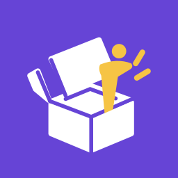
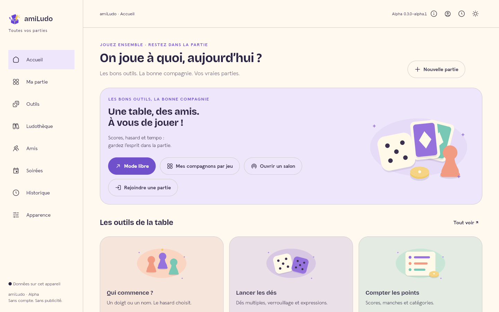
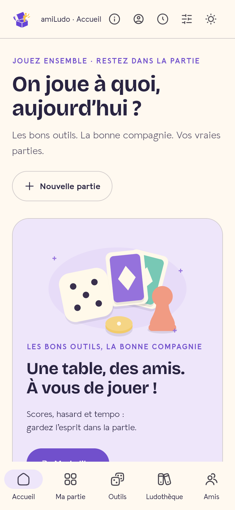
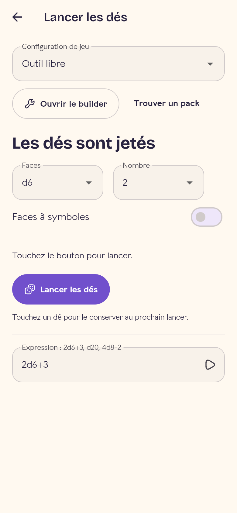
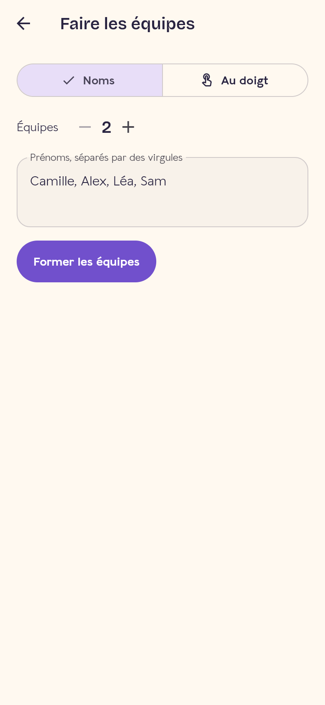
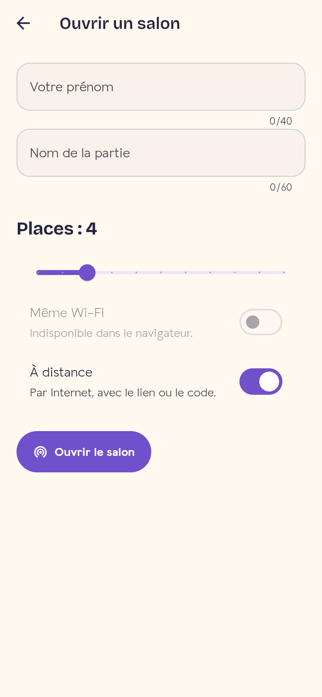

<p align="center">
  
</p>

<h1 align="center">amiLudo</h1>

<p align="center">
  <strong>Every tool. Around the table.</strong><br>
  The open-source board game night companion: scores, dice, timers, teams,<br>
  game shelf, friends, rooms joined by QR code and game nights with sign-ups.
</p>

<p align="center">
  <a href="https://techmefr.github.io/amiludo/app/"></a>
  <a href="https://github.com/techmefr/amiludo/releases"></a>
</p>

<p align="center">
  
  
  
  
  
  <a href="LICENSE"></a>
</p>

<p align="center"><a href="README.md">Français</a></p>

<p align="center">
  
</p>

## 🎲 Why amiLudo

A game night often means one phone for dice, paper for scores, another phone for the timer and a debate about who goes first. amiLudo puts all of it in one app designed to sit **in the middle of the table**: large controls, simple gestures, and themes each player can tune.

- **Offline first**: everything you need during a game works without a network, and your data stays on the device.
- **No mandatory account, no ads**. An account is only needed for online game nights.
- **One Flutter codebase** for Android, iOS and the web.

## ✨ Features

| | |
|---|---|
| 🧮 **Scores** | Rounds, categories, negative or decimal scores, cooperative goals, resources and statuses, undo/redo, rankings, ties, rematch |
| 🎲 **Randomness** | Lockable multi-dice, expressions (`2d6+1`), first player by finger or name, turn order, coin, weighted wheel, token bag, secret roles |
| 👥 **Teams** | From typed names, from the players in the room, or from **fingers on the screen** |
| ⏱️ **Time** | Free timer, per-turn time, per-player time banks with increment, settings kept per table |
| 📚 **Game shelf** | Your games on shelves, with genres, player count, duration and linked packs |
| ❤️ **Friends** | Liked and avoided genres, available time, refused games and games they love despite the genre |
| 🤔 **What do we play tonight?** | Suggestions based on who is there, what they want and how much time you have |
| 📸 **Memories** | Notes, highlights and photos, with a private gallery exchanged as an encrypted file |
| 🧩 **Game packs** | Dice, roles, scoring rules, characters from lists or boosters, and an installable community gallery |
| 🎨 **Appearance** | Four worlds, eleven palettes, seven fonts, dark mode, and optional motion, sounds and haptics |
| 💾 **Data** | Local SQLite, history, CSV and JSON export, full backup and restore |

<p align="center">
  
  
  
  
</p>

## 📡 Playing together

- **Rooms**:
  - the host shares a room by **QR code, short code or link**;
  - others join on the **same Wi‑Fi**, with no server and automatic discovery, or **remotely** over the Internet;
  - the host accepts or refuses each request, then starts the game.
- **Game nights**:
  - date, place, seats and planned games;
  - guests answer *yes*, *maybe* or *no*, and seats are filled in answer order, then a waitlist;
  - without a server, the host can record answers by hand.
- **Offline sharing**: a whole session moves between phones as an **animated QR code**. Fountain coding lets you start scanning midway and miss frames.

## 🚀 Getting started

Try it: [open the web app](https://techmefr.github.io/amiludo/app/). Load it online once so it can cache itself, and it then works offline. On iPhone and iPad, use the web app. For Android, see the [test APKs](https://github.com/techmefr/amiludo/releases).

```sh
cd app
flutter pub get
flutter analyze
flutter test
flutter run -d chrome
```

Flutter 3.47.9 / Dart 3.13.7. To build for the web, run `bash scripts/build_web.sh`. Online features (remote rooms, accounts, game nights) are optional and need a [Supabase](https://supabase.com) project, passed at build time through `SUPABASE_URL`, `SUPABASE_PUBLISHABLE_KEY` and `AMILUDO_LINK_BASE`. The database schema is in [`server/supabase/migrations`](server/supabase/migrations). Without those variables, the app stays fully local.

## 🏗️ Architecture

The code follows OSDD:

- **Layers**: functional layers (one per feature) and technical layers.
- **Inside a feature**: `domain` (entities, gateways, use cases), then `data`, then `presentation` (Cubit, screens).
- **Libraries**:
  - flutter_bloc + get_it;
  - go_router;
  - Drift/SQLite (native on mobile, Wasm on the web);
  - WebSocket + UDP discovery on the LAN, Supabase Realtime for remote rooms.

See [docs/TECHNOLOGY.md](docs/TECHNOLOGY.md).

## 📍 Status

**Public alpha 0.4.0.** The catalogue lists 170 features: 113 are shipped and 57 are planned or incomplete. See the [feature catalogue](docs/FEATURES.md) and the [actual status](docs/APP-STATUS.md).

What remains open:
- testing on physical devices: Wi‑Fi discovery, camera, sleep, screen readers;
- the full English translation.

## 🤝 Contributing

See the [testing guide](TESTING.md), the [contribution guide](CONTRIBUTING.md) and [SECURITY.md](SECURITY.md). Issues are welcome in French or English.

Source code is under the [MIT licence](LICENSE). Bundled fonts keep their OFL licences, which are also listed in the app’s About screen.
