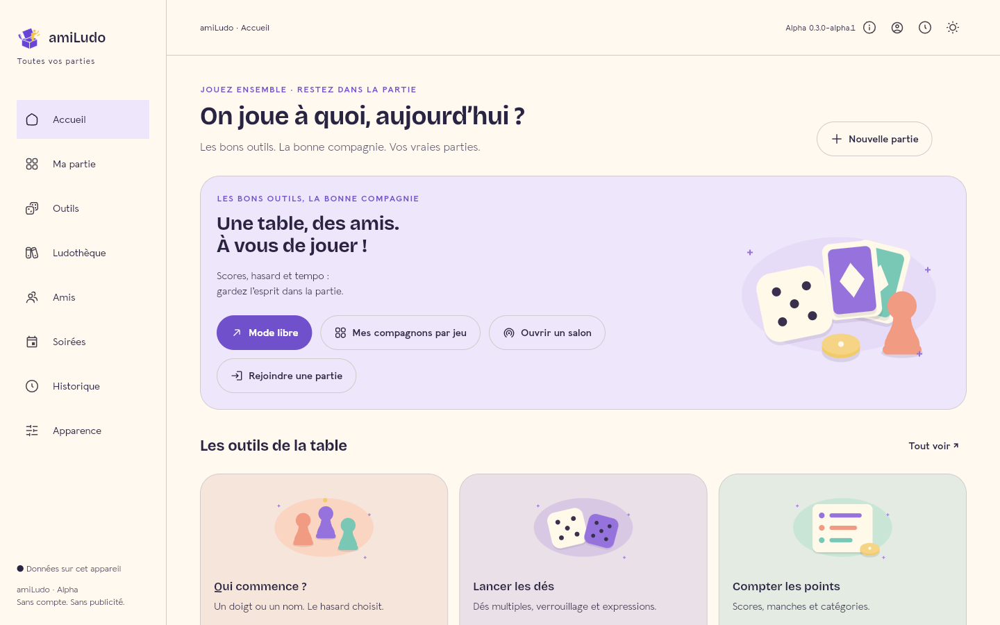
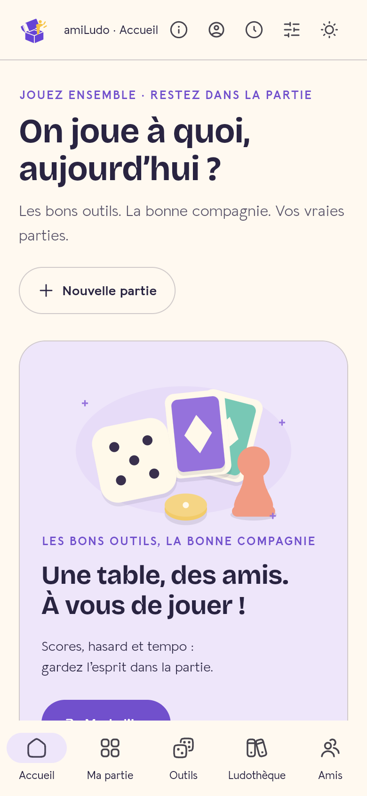
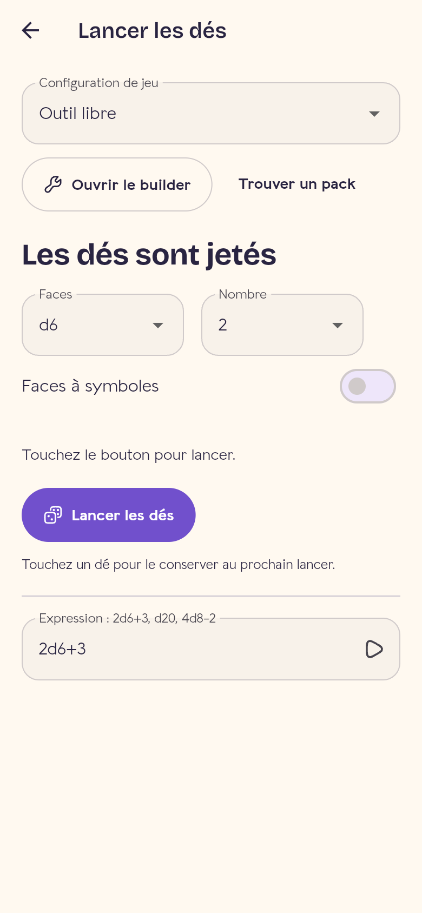
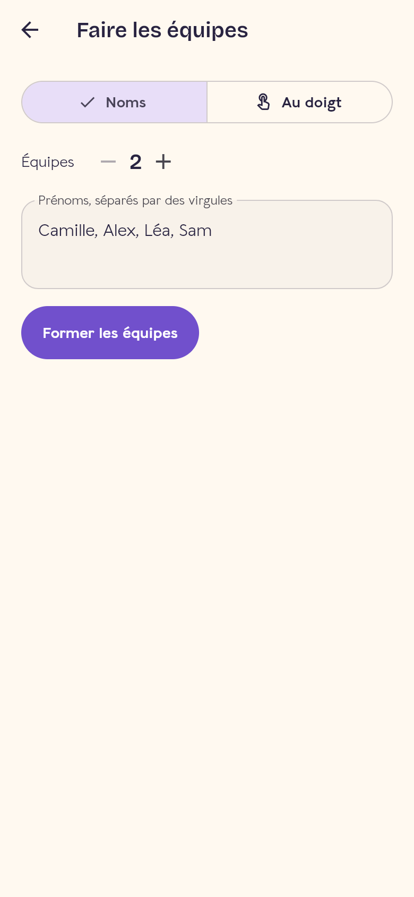
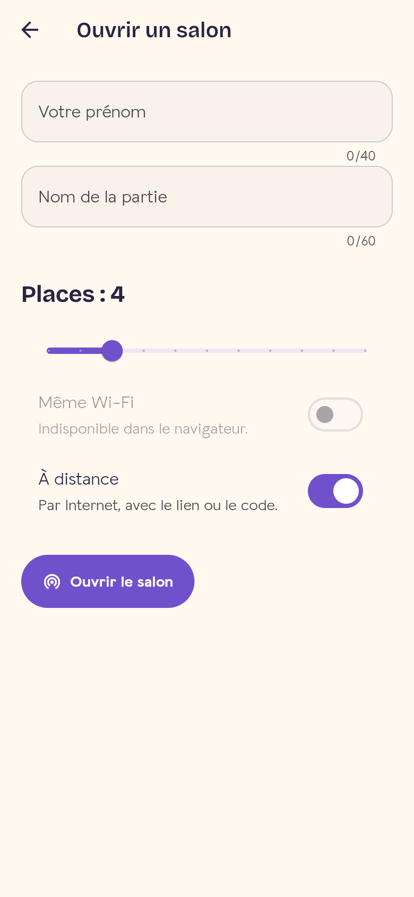
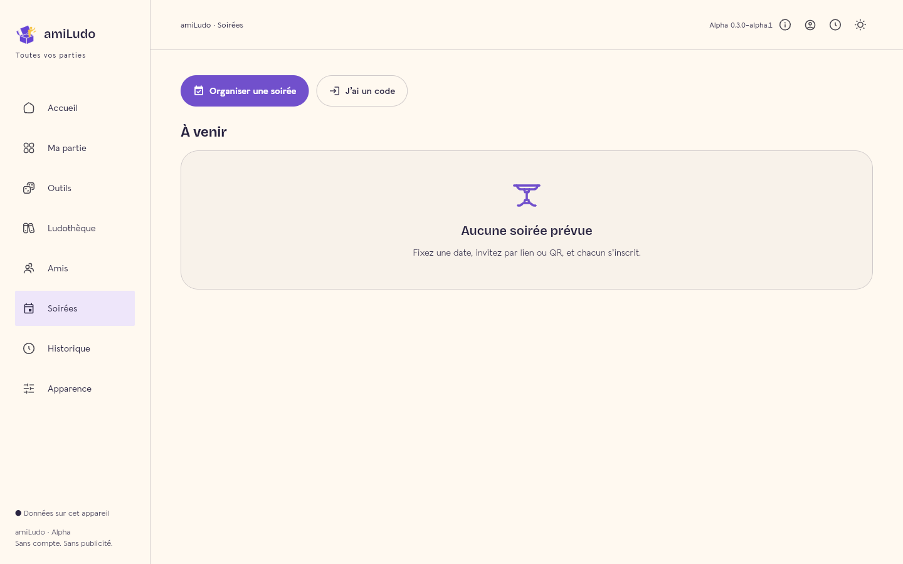

<p align="center">
  
</p>

<h1 align="center">amiLudo</h1>

<p align="center">
  <strong>Every tool. Around the table.</strong><br>
  The open source companion for board game nights: scores, dice, timers, teams,<br>
  game shelf, friends, lobbies you join by QR code and evenings with sign-ups.
</p>

<p align="center">
  <a href="https://techmefr.github.io/amiludo/app/"></a>
  <a href="https://github.com/techmefr/amiludo/releases"></a>
</p>

<p align="center">
  
  
  
  
  
  <a href="LICENSE"></a>
</p>

<p align="center">
  <a href="#-what-you-can-do">Features</a> ·
  <a href="#-playing-together">Playing together</a> ·
  <a href="#-getting-started">Getting started</a> ·
  <a href="#-architecture">Architecture</a> ·
  <a href="#-documents">Documents</a>
</p>

<p align="center">
  
</p>

---

## 🎲 Why amiLudo

A game night is often one phone for the dice, a sheet of paper for the scores, another phone for the timer and a debate about who starts. amiLudo gathers all of it in a single app designed to sit **in the middle of the table**: large controls, simple gestures, and themes each player can set for themselves.

- **Offline first**: everything you need during a game works without a network, with data kept on the device.
- **No account required, no ads**. An account is only needed for online evenings.
- **One Flutter codebase** for Android, iOS and the web.

## ✨ What you can do

| | |
|---|---|
| 🧮 **Scores** | Rounds, categories, negative or decimal scores, cooperative goals, resources and statuses, undo and redo, ranking, ties, rematch |
| 🎲 **Chance** | Multiple lockable dice, expressions (`2d6+1`), who starts (by finger or by name), turn order, coin, weighted wheel, token bag, secret roles |
| 👥 **Teams** | From typed names, lobby players or **fingers placed on the screen** |
| ⏱️ **Time** | Free timer, time per turn, per-player reserve with increment, settings kept per table |
| 📚 **Game shelf** | Your games on shelves, with genres, player count, duration and linked packs |
| ❤️ **Friends** | Liked or avoided genres, available time, refused games or loved ones despite the genre |
| 🤔 **What do we play tonight?** | Suggestions based on the friends present, their wishes and the time you have |
| 📸 **Memories** | Notes, highlights and photos, plus a private gallery exchanged as an encrypted file |
| 🧩 **Game packs** | Dice, roles, scoring rules, characters by lists or boosters, and an installable community gallery |
| 🎨 **Appearance** | Four universes (Playroom, Cyberdeck, Orbital, Notebook), eleven palettes, seven fonts, dark mode, animations, sounds and vibrations you can turn off |
| 💾 **Data** | Local SQLite, history, CSV and JSON export, full backup and restore |

<p align="center">
  
  
  
  
</p>

## 📡 Playing together

**Game lobbies.** The host opens a lobby and shares it by **QR code, short code or link**. Others join:

- **on the same Wi-Fi**, with no server: the app finds the lobby by itself;
- **remotely**, over the Internet, with the link or the code.

The host accepts or declines each request, closes the lobby, then starts the game with the accepted players.

**Evenings.** Date, place, number of seats and planned games. Each guest answers *yes*, *maybe* or *no*. Seats go in order of answers, then people move to a waiting list. The invitation is shared by link, code or QR. Without a server, the host can also record the answers of their friends themselves.

**Offline sharing.** A full session (packs, dice, sheets, players) moves from one phone to another as an **animated QR code**. Fountain coding lets you start scanning midway and miss frames.

<p align="center">
  
</p>

## 🚀 Getting started

**Play right away**: [open the web app](https://techmefr.github.io/amiludo/app/). Open it once with a connection so it caches itself, after which it works offline. On iPhone and iPad, use the web version. On Android, a [test APK](https://github.com/techmefr/amiludo/releases) is available.

**Develop**: Flutter **3.47.9** and Dart **3.13.7**. Dependencies are locked in `app/pubspec.lock`.

```sh
cd app
flutter pub get
flutter analyze
flutter test
flutter run -d chrome
```

**Build the web app**: from the root, run `bash scripts/build_web.sh`. The public path is set with `APP_BASE_PATH`.

**Online features (optional)**: remote lobbies, accounts and online evenings use [Supabase](https://supabase.com). Just provide the project at build time:

```sh
SUPABASE_URL=https://xxxx.supabase.co \
SUPABASE_PUBLISHABLE_KEY=sb_publishable_xxx \
AMILUDO_LINK_BASE=https://your-site/app/# \
bash scripts/build_web.sh
```

The database schema is in [`server/supabase/migrations`](server/supabase/migrations). Without these variables, the app stays entirely local. The Wi-Fi lobby works in every case, except in a browser.

**Continuous integration**: on every push to `main`, GitHub Actions analyzes the code, runs the tests, publishes the web version to GitHub Pages and builds a test Android APK. The Supabase project variables are read from the repository *variables*.

## 🏗️ Architecture

The code follows the **OSDD** architecture, in independent layers:

```
app/lib/
├── layers/
│   ├── functional/   Account · Appearance · Evenings · Friends · Game · History · Library
│   │                 Lobby · Memories · Random · Sharing · Templates · Timer · Workspace
│   │     └── <Feature>/domain (entities, gateways, use_cases) → data → presentation (cubit, screens)
│   └── technical/    About · Appearance · Feedback · Files · Network · Qr · Storage · Theme · Transfer
├── dependencies.dart  injection (get_it)
├── router.dart        navigation (go_router)
└── main.dart
```

- State flows through `flutter_bloc` (Cubit), then use cases, then gateways behind contracts.
- A feature only sees another feature's `domain`, and `technical/` never imports `functional/`.
- Data is stored with Drift and SQLite, native on mobile and Wasm on the web.
- The network uses WebSocket and UDP discovery on the local Wi-Fi, or Supabase Realtime remotely.

Details are in [docs/TECHNOLOGY.md](docs/TECHNOLOGY.md).

## 📍 Where the project stands

**Public alpha 0.4.0.** The catalogue lists **170 features: 113 are shipped, 57 are planned or incomplete**. Tests on real phones remain to be done: Wi-Fi discovery, camera, sleep, screen readers. The English translation is partial. The full status is in [docs/APP-STATUS.md](docs/APP-STATUS.md), and what comes next is in [the roadmap](docs/ROADMAP.md).

## 🤝 Contributing

Feedback from players is as valuable as code. The [testing guide](TESTING.md) explains what to try, and the [contribution guide](CONTRIBUTING.md) explains how to propose a pack or a fix. [Issues](https://github.com/techmefr/amiludo/issues) are open in French and in English. Found a vulnerability? See [SECURITY.md](SECURITY.md).

## 📄 Documents

- [Feature catalogue and status](docs/FEATURES.md)
- [Actual state of the app](docs/APP-STATUS.md)
- [Roadmap](docs/ROADMAP.md)
- [Technical choices](docs/TECHNOLOGY.md)
- [Packs and builders](docs/PACKS.md)
- [Extended target catalogue](docs/VISION-COMPLETE.md)
- [Presentation for players (PDF)](docs/presentation/Amiludo-presentation-joueurs.pdf)
- [Flutter app guide](app/README.md)

## License

The code and original concepts are under the [MIT license](LICENSE). Bundled fonts keep their OFL licenses, and their notices are also shown in the "About" screen. The logo is called "The box" ([design/logo](design/logo)).
